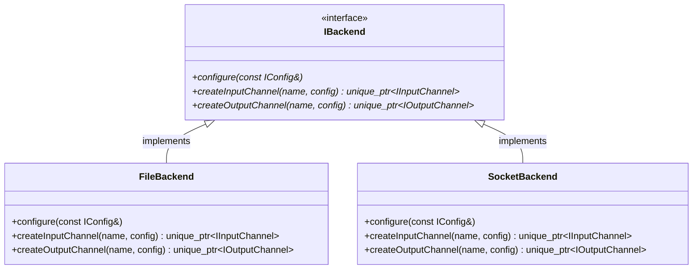
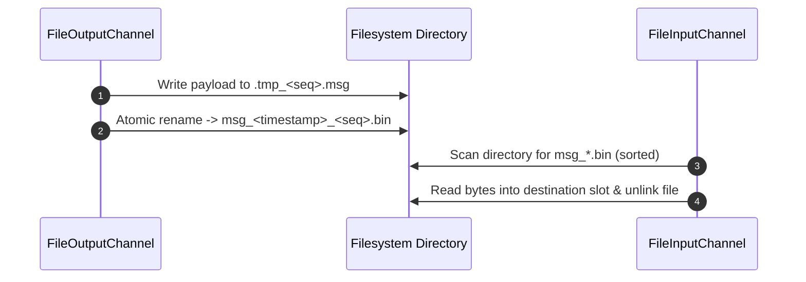

# 001: Initial File & UDP Socket Transports (`backend/file`, `backend/socket`)

## 1. Overview & Problem Statement

### Why It's Needed
In the earliest stage of the Proxy project (`72cff56` – `345e935`), the architecture required a clean transport abstraction (`Backend::IBackend`, `Backend::IInputChannel`, `Backend::IOutputChannel`) that allowed message handlers to operate identically over either durable on-disk directory queues or live UDP network datagrams without recompiling or altering handler business logic.

Furthermore, transport implementations needed to be strictly isolated from `core` domain dependencies, relying solely on `backend-interface` and `proxylog`.

### The Solution
1. **Transport Interface (`backend/interface`)**: Defined `IBackend`, `IInputChannel`, `IOutputChannel`, and `IConfig`, along with the `Backend::createBackend()` factory entry point linked at compile time per handler executable.
2. **Directory-Watched File Transport (`backend/file`)**: Implemented `FileBackend`, `FileInputChannel`, and `FileOutputChannel` using atomic temporary-file-plus-rename writes and lexicographical directory polling.
3. **UDP Datagram Transport (`backend/socket`)**: Implemented `SocketBackend`, `SocketInputChannel`, and `SocketOutputChannel` supporting non-blocking IPv4/IPv6 UDP datagram reception and transmission.

---

## 2. Architecture & How It Works

### 2.1 Transport Abstraction Hierarchy



### 2.2 Atomic File Channel Write & Consume Flow



---

## 3. Design Decisions

### 3.1 Compile-Time Backend Binding via `Backend::createBackend()`
- **Decision**: Each transport library (`backend-file`, `backend-socket`, etc.) implements `std::unique_ptr<Backend::IBackend> Backend::createBackend()`, and CMake links each handler against each discovered backend to produce `<handler>_<backend>` binaries.
- **Rationale**: Eliminates dynamic shared-library (`dlopen`) runtime overhead and keeps Distroless container images self-contained with only the exact transport dependencies required.

### 3.2 Atomic Write-Then-Rename in `FileOutputChannel`
- **Decision**: Write outgoing messages to a hidden temporary file before renaming to the final message filename.
- **Rationale**: Guarantees that `FileInputChannel` never reads a partially written file when polling the directory concurrently from another process.

---

## 4. Concrete Examples

### 4.1 Channel Configuration Resolution
```ini
# File backend configuration
[channel.orders]
path = /tmp/proxy_orders

# Socket backend configuration
[channel.orders]
host = 127.0.0.1
port = 9001
dest_host = 127.0.0.1
dest_port = 9002
```

---

## 5. Tasks / Checklist

- [x] Define `IBackend`, `IInputChannel`, `IOutputChannel`, and `IConfig` in `backend/interface`.
- [x] Implement `FileBackend`, `FileInputChannel`, and `FileOutputChannel` in `backend/file`.
- [x] Implement `SocketBackend`, `SocketInputChannel`, and `SocketOutputChannel` in `backend/socket`.
- [x] Separate `IInputChannel` header declaration from implementation (`345e935`).

