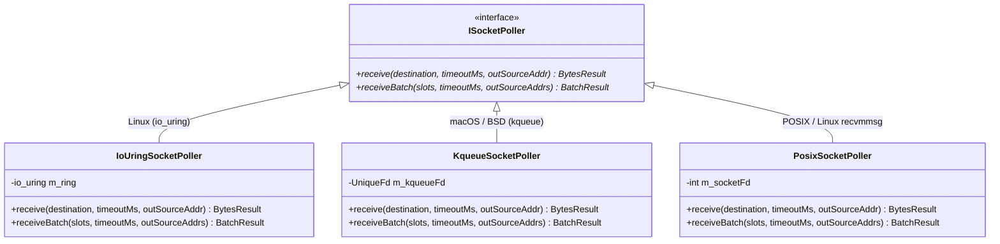
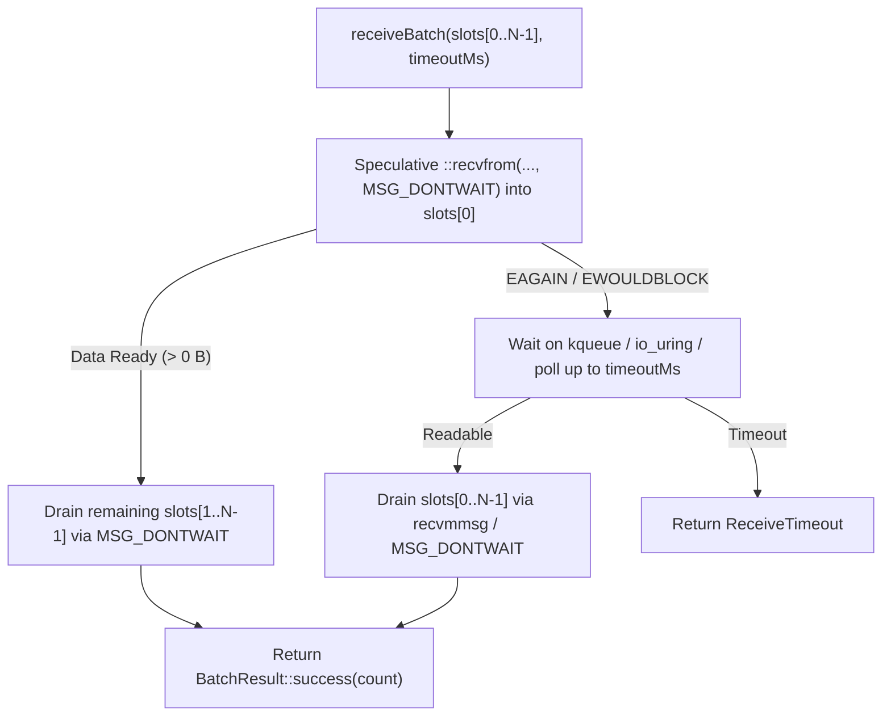

# 002: Platform Socket Poller & Async I/O Multiplexing (`ISocketPoller`)

## 1. Overview & Problem Statement

### Why It's Needed
In `4480ad3` – `5ae8860`, high-speed networking channels (`SocketInputChannel`, `UdsInputChannel`, and `UdpInputChannel`) faced substantial performance bottlenecks when using standard synchronous POSIX `poll()` + `recvfrom()`:
1. **Per-Datagram Syscall Overhead**: Invoking `poll()` and `recvfrom()` for individual packets incurred user-to-kernel context switches on every datagram.
2. **Divergent OS Async Primitives**: Linux 5.1+ provides submission/completion rings via **`io_uring`** and batched **`recvmmsg`**, macOS/BSD provides **`kqueue`**, and generic POSIX environments require `poll()`.
3. **Code Duplication**: Sharing polling logic between UDP sockets (`backend/socket`) and Unix Domain Sockets (`backend/uds`) required consolidating the poller hierarchy into `backend/interface`.

### The Solution
1. **Unified `Backend::ISocketPoller` Interface**: Defined a cross-platform socket polling abstraction in `backend/interface/include/backend/ISocketPoller.hpp` with `createSocketPoller(socketFd)` factory selection.
2. **Platform-Specialized Implementations**:
   - `IoUringSocketPoller` (Linux): Asynchronous ring submission/completion via `liburing`.
   - `KqueueSocketPoller` (macOS / BSD): Kernel event queue (`EVFILT_READ`) with batched `kevent` array retrieval (`0dce024`) and speculative non-blocking burst draining (`03ff4c8`).
   - `PosixSocketPoller` (Linux / POSIX fallback): Vectorized `::recvmmsg` batch reception on Linux (`5ae8860`) and `poll()` + non-blocking `recvfrom()` loop on generic POSIX.

---

## 2. Architecture & How It Works

### 2.1 Poller Class Hierarchy



### 2.2 Speculative Non-Blocking Burst Drain (`03ff4c8`)



---

## 3. Design Decisions

### 3.1 Speculative Non-Blocking Read Before Kernel Wait
- **Decision**: Before entering `kevent()`, `poll()`, or `io_uring_wait_cqe()`, pollers attempt an immediate non-blocking `recvfrom(..., MSG_DONTWAIT)`.
- **Rationale**: Under sustained burst load, the socket receive buffer already contains queued datagrams. Reading immediately bypasses the kernel event-wait syscall altogether, cutting per-batch syscall count in half.

### 3.2 Consolidated Pollers in `backend/interface` (`d38e3ed`)
- **Decision**: Host `ISocketPoller`, `KqueueSocketPoller`, `IoUringSocketPoller`, `PosixSocketPoller`, and `SocketAddress` directly in `backend/interface`.
- **Rationale**: Both `backend/socket` (UDP), `backend/uds` (Unix Domain Sockets), and `core/net` (`UdpInputChannel`) reuse the exact same battle-tested poller implementations without duplicating platform `#ifdef` logic.

---

## 4. Concrete Examples

### 4.1 Batched Polling with Source Provenance
```cpp
std::unique_ptr<Backend::ISocketPoller> poller = Backend::createSocketPoller(m_fd.get());

std::array<Backend::BufferSlot, 16> slots = /* ... */;
std::array<Backend::SocketAddress, 16> sourceAddrs {};

auto result = poller->receiveBatch(slots, timeoutMs, sourceAddrs);
if (result.hasValue()) {
    for (std::size_t i = 0; i < result.value(); ++i) {
        // slots[i].filledSpan() holds packet i; sourceAddrs[i] holds client IP:port
    }
}
```

---

## 5. Tasks / Checklist

- [x] Define `Backend::ISocketPoller` interface and factory `Backend::createSocketPoller`.
- [x] Implement `KqueueSocketPoller` for macOS/BSD (`4480ad3`, `0dce024`).
- [x] Implement `IoUringSocketPoller` for Linux (`4480ad3`, `8e9b787`).
- [x] Implement `PosixSocketPoller` with Linux `::recvmmsg` vectorization (`5ae8860`).
- [x] Add speculative non-blocking ingress fast-path (`03ff4c8`).
- [x] Consolidate socket and UDS pollers into `backend/interface` (`d38e3ed`).

