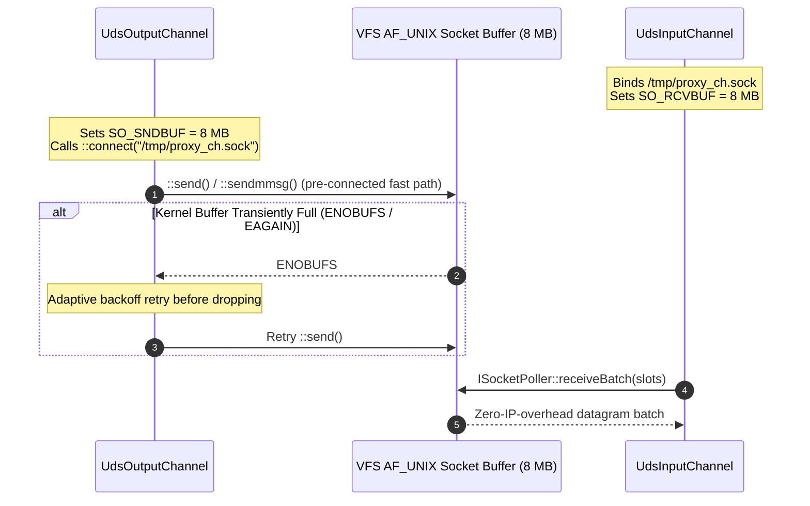

# 003: Unix Domain Socket IPC & Pre-Connected Datagram Tuning (`backend/uds`)

## 1. Overview & Problem Statement

### Why It's Needed
When deploying multi-process handler chains on the same physical host or within shared container pods (`19e2707` – `bf77264`), UDP loopback sockets (`127.0.0.1`) incurred unnecessary network stack overhead (IP header checksums, routing table lookups, and netfilter hooks) and suffered from packet drops (~19% loss) under 100,000-message burst workloads due to default OS socket buffer limits and unconnected `sendto()` peer-resolution contention.

### The Solution
1. **Unix Domain Socket Datagram Transport (`backend/uds`)**: Implemented `UdsBackend`, `UdsInputChannel`, and `UdsOutputChannel` using `AF_UNIX` / `SOCK_DGRAM` filesystem socket paths, bypassing the IP network stack while preserving message datagram boundaries.
2. **Pre-Connected Datagram Sockets (`837ae99`, `efe6048`)**: Connected `SocketOutputChannel` and `UdsOutputChannel` descriptors once via `::connect()` during initialization (or lazily on peer startup) and transmitted via `::send()` / `::sendmmsg()`, avoiding per-packet destination address lookup in the kernel.
3. **8 MB Socket Buffer Expansion & Adaptive `ENOBUFS` Backoff (`bece0e2`, `bf77264`, `4fc454d`)**: Expanded `SO_RCVBUF` and `SO_SNDBUF` to 8 MB (`8 * 1024 * 1024`) with graceful OS cap fallback, handled macOS `EISCONN` quirks on connected sockets, and added bounded microsecond backoff when kernel `ENOBUFS` / `EAGAIN` transient saturation occurs.

---

## 2. Architecture & How It Works

### 2.1 Pre-Connected `AF_UNIX` Datagram Pipeline



---

## 3. Design Decisions

### 3.1 `SOCK_DGRAM` over `SOCK_STREAM` for UDS
- **Decision**: Use `AF_UNIX` with `SOCK_DGRAM` rather than `SOCK_STREAM`.
- **Rationale**: Preserves atomic message framing boundaries inside the kernel so `receiveBatch` always returns complete `MessageEnvelope` frames without requiring user-space stream ring reassembly.

### 3.2 Lazy Reconnection & `EISCONN` Resilience (`efe6048`, `bf77264`)
- **Decision**: If the consumer process has not bound its UDS path yet when the producer starts, `UdsOutputChannel` falls back to `::sendto()` and lazily promotes the socket to `m_connected = true` once `::connect()` succeeds. If a peer restarts (`ECONNREFUSED` / `ENOENT`), the channel resets `m_connected` and reconnects transparently.
- **Rationale**: Decouples process startup order in `chain_runner.py` while still achieving pre-connected `::send()` throughput once both processes are live.

### 3.3 Channel Identity Preservation on Move (`80f164e`)
- **Decision**: Ensure move constructors/assignments of `UdpInputChannel`, `UdpOutputChannel`, `SocketInputChannel`, and `UdsInputChannel` preserve base-class `m_name` and file descriptor ownership via `Common::Io::UniqueFd`.
- **Rationale**: Prevents empty channel names in logs and telemetry when channels are moved into handler containers.

---

## 4. Concrete Examples

### 4.1 UDS Channel Configuration
```ini
[channel.verified_orders]
path = /tmp/proxy_verified_orders.sock
```

### 4.2 Socket Buffer Sizing Helper
```cpp
constexpr int targetBufSize = 8 * 1024 * 1024; // 8 MB burst absorption
::setsockopt(fd, SOL_SOCKET, SO_RCVBUF, &targetBufSize, sizeof(targetBufSize));
```

---

## 5. Tasks / Checklist

- [x] Implement `UdsBackend`, `UdsInputChannel`, and `UdsOutputChannel` in `backend/uds` (`19e2707`).
- [x] Pre-connect datagram sockets with `::connect()` + `::send()` in `SocketOutputChannel` and `UdsOutputChannel` (`837ae99`).
- [x] Add lazy reconnect resilience and resolve `EISCONN` / `ENOBUFS` saturation drops under 100k burst load (`efe6048`, `bf77264`).
- [x] Expand socket send and receive buffers to 8 MB (`bece0e2`).
- [x] Preserve channel names across move operations (`80f164e`).

