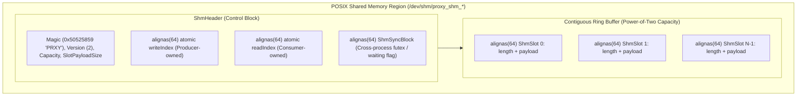
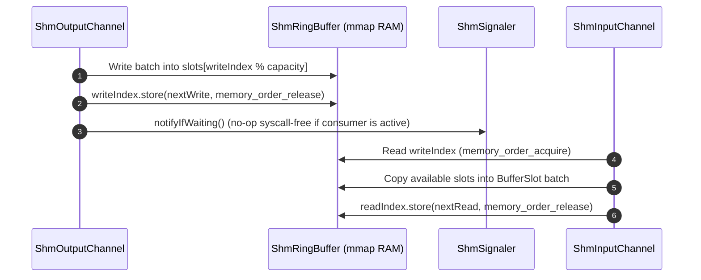

# 004: Kernel-Bypass Shared Memory Transport (`backend/shm`)

## 1. Overview & Problem Statement

### Why It's Needed
Even with Unix Domain Sockets (`backend/uds`) and vectorized `recvmmsg`/`sendmmsg`, inter-process communication still crossed the OS kernel boundary on every batch (`f6f16cd` – `1b05e9e`). In ultra-low-latency pipelines:
1. **Kernel Mode Switches**: System calls (`send`, `recv`) incur user-to-kernel context switches and VFS socket buffer copies.
2. **Latency Jitter**: Kernel lock contention and scheduler wakeups add 8–15 µs of hop latency.

### The Solution
Implemented `backend/shm` (`ShmBackend`, `ShmInputChannel`, `ShmOutputChannel`, `ShmRingBuffer`, `ShmSignaler`), a **kernel-bypass, lock-free shared memory IPC transport** backed by POSIX shared memory (`shm_open`, `mmap`):
1. **Cache-Line Aligned SPSC Ring (`ShmHeader` & `ShmSlot`)**: Producer and consumer communicate directly through shared physical RAM pages mapped into their virtual address spaces, separating `writeIndex` and `readIndex` onto dedicated 64-byte cache lines to prevent MESI false sharing.
2. **Adaptive Kernel-Bypass Event Signaling (`ShmSignaler`, `1b05e9e`)**: Under active traffic, producer and consumer transfer batches purely in user space with zero syscalls. When idle, the consumer spins briefly before parking on a cross-process futex/condition variable, and the producer issues a wakeup notification only when `waiting` is set.

---

## 2. Architecture & How It Works

### 2.1 Shared Memory Layout



### 2.2 Producer-Consumer Flow with Conditional Notification



---

## 3. Design Decisions

### 3.1 False-Sharing Prevention via `alignas(64)`
- **Decision**: Place `writeIndex`, `readIndex`, `ShmSyncBlock`, and each `ShmSlot` on 64-byte hardware cache line boundaries.
- **Rationale**: Prevents producer writes to `writeIndex` from invalidating the L1/L2 cache line holding `readIndex` on the consumer's CPU core.

### 3.2 Conditional Notification (`1b05e9e`)
- **Decision**: Track an atomic `waiting` state in `ShmSyncBlock` so `ShmOutputChannel` only invokes OS wakeup primitives when `ShmInputChannel` has actually gone to sleep after an idle spin window.
- **Rationale**: Eliminates 100% of kernel syscalls during sustained message bursts while keeping idle CPU utilization near 0%.

---

## 4. Concrete Examples

### 4.1 Declarative Shared Memory Chain (`chains/example_shm_chain.toml`)
```toml
backend = "shm"

[config]
"channel.orders.path" = "/tmp/proxy_shm_orders"
"shm.capacity" = 4096

[[handlers]]
name = "sender"
type = "dummy_send"
output_channel = "orders"

[[handlers]]
name = "receiver"
type = "print_handler"
input_channel = "orders"
```

---

## 5. Tasks / Checklist

- [x] Implement `ShmRingBuffer` and `ShmHeader` with 64-byte cache-line alignment (`f6f16cd`).
- [x] Implement `ShmSignaler` with conditional kernel-bypass event signaling (`1b05e9e`).
- [x] Implement `ShmBackend`, `ShmInputChannel`, and `ShmOutputChannel` supporting `receiveSlot`, `receiveBatch`, `send`, and `sendBatch`.
- [x] Add Catch2 unit tests (`test/TestShmBackend.cpp`) and benchmark comparisons (`benchmark/`).

