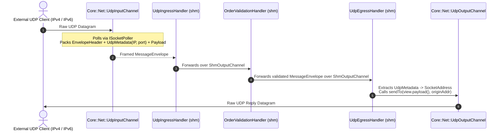

# 005: Reusable Network UDP Channels (`UdpInputChannel` & `UdpOutputChannel`)

## 1. Overview & Problem Statement

### Why It's Needed
In multi-stage pipelines (`51f8fdb` – `8e9b787`), inter-handler communication inside a host or pod used high-speed IPC (`backend/shm` or `backend/uds`), while external clients outside the host communicated over standard network UDP datagrams.

Because each handler executable is compiled against a single internal transport backend (e.g. `udp_ingress_handler_shm`), the edge gateway handlers (`UdpIngressHandler` and `UdpEgressHandler`) needed reusable, high-performance UDP network channels in `core/net` that could listen to or reply to external IPv4/IPv6 UDP clients independently of the internal pipeline backend (`shm`, `uds`, `inproc`, `file`).

### The Solution
1. **`Backend::SocketAddress`**: Added a strongly-typed IPv4/IPv6 endpoint value type (`backend/interface/include/backend/SocketAddress.hpp`) capable of round-tripping network-byte-order addresses without string formatting on the hot path.
2. **`Core::Net::UdpInputChannel`**: Implemented an external UDP listener channel that uses `Backend::ISocketPoller` to drain raw client UDP datagrams, captures the sender's `SocketAddress`, and wraps each datagram into a `Backend::MessageEnvelope` with `ProtocolId::Udp` and `Backend::UdpMetadata` (preserving IPv4 or 16-byte IPv6 source address and port).
3. **`Core::Net::UdpOutputChannel`**: Implemented an external UDP sender channel supporting both default destination transmission (`send`, `sendBatch`) and dynamic origin-directed reply (`sendTo(payload, SocketAddress)`).

---

## 2. Architecture & How It Works

### 2.1 External UDP Gateway + Internal IPC Pipeline



---

## 3. Design Decisions

### 3.1 Separating External Edge Channels (`Core::Net`) from Internal Bus Backends (`Backend::*`)
- **Decision**: Place `UdpInputChannel` and `UdpOutputChannel` in `core/include/core/net/` while implementing `Backend::IInputChannel` and `Backend::IOutputChannel`.
- **Rationale**: Allows `UdpIngressHandler` to register `UdpInputChannel` as its input (polled automatically by `IExecutionStrategy`) and register an `IBackend` channel (such as `ShmOutputChannel`) as its output, bridging external UDP traffic onto any internal IPC bus without special-casing the execution strategy.

### 3.2 Full IPv4 and IPv6 Provenance (`8e9b787`)
- **Decision**: Store both `uint32_t srcIp` (IPv4) and `std::array<uint8_t, 16> srcIpv6` + `uint8_t addressFamily` inside `Backend::UdpMetadata`.
- **Rationale**: Prevents IPv6 client addresses from being silently dropped or zeroed when replying via `UdpEgressHandler` with `reply_to_origin = true`.

---

## 4. Concrete Examples

### 4.1 Binding `UdpInputChannel` in `UdpIngressHandler::onConfigure`
```cpp
auto udpIn = std::make_unique<Core::Net::UdpInputChannel>(
    host,
    port,
    "udp_external_in");
registerInputChannel(std::move(udpIn));

m_outputChannel = registerOutputChannel(
    backend().createOutputChannel(outChannelName, config));
```

---

## 5. Tasks / Checklist

- [x] Implement `Backend::SocketAddress` supporting IPv4 and IPv6 endpoints (`51f8fdb`, `5932201`).
- [x] Implement `Core::Net::UdpInputChannel` packing `UdpMetadata` into `MessageEnvelope` (`51f8fdb`).
- [x] Implement `Core::Net::UdpOutputChannel` with `sendTo(payload, originAddr)` (`5932201`).
- [x] Fix IPv6 origin preservation and datagram truncation edge cases (`8e9b787`).

