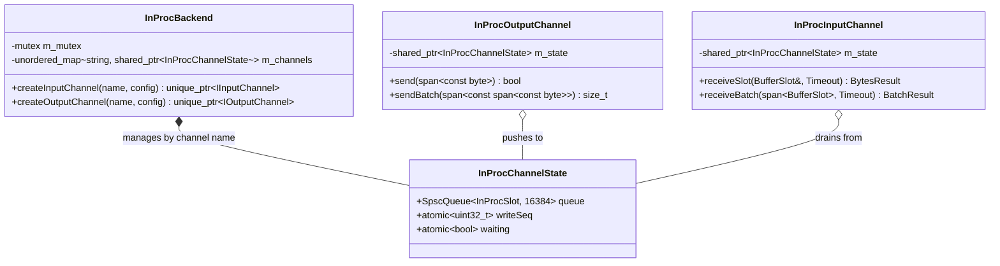

# 006: In-Process Pipeline Channel Backend & Benchmark Runner (`backend/inproc`)

## 1. Overview & Problem Statement

### Why It's Needed
In `fff378d` – `8b48d82`, high-throughput pipelines needed to support two complementary deployment models using the exact same `IHandler` implementations:
1. **Multi-Process Containerized Topology**: Separate OS processes/containers per handler connected via IPC (`backend/shm`, `backend/uds`) for fault isolation and independent rolling deployments.
2. **Single-Process In-Memory Topology (`backend/inproc`)**: Multiple handlers composed within a single process address space, communicating through lock-free in-memory SPSC ring buffers (`Common::Queue::SpscQueue`) with zero OS syscalls, zero IPC context switches, and L2/L3 cache locality (15–45 ns per hop).

### The Solution
1. **`Backend::InProc::InProcBackend`**: Implemented an in-memory channel hub (`backend/inproc`) that dynamically pairs `InProcInputChannel` and `InProcOutputChannel` instances by logical channel name around shared `InProcChannelState` ring buffers.
2. **Lock-Free Ring & Adaptive Wait (`InProcChannelState`)**: Backed each channel by a power-of-two `Common::Queue::SpscQueue` with `Common::Compat::atomic_wait` / `atomic_notify_all` wakeup signaling when idle.
3. **Comparative Benchmark Suite (`benchmark/`)**: Integrated `--strategy inproc` into `proxy_benchmark` to compare 20,000 and 100,000 message burst workloads across `Direct`, `InProc`, `SHM`, `UDS`, and `UDP`.

---

## 2. Architecture & How It Works

### 2.1 In-Process Shared Channel Hub



---

## 3. Design Decisions

### 3.1 Name-Paired Shared State in `InProcBackend`
- **Decision**: When `createOutputChannel("orders", cfg)` and `createInputChannel("orders", cfg)` are called on the same `InProcBackend` instance, both receive a `std::shared_ptr<InProcChannelState>` pointing to the same lock-free SPSC ring buffer.
- **Rationale**: Allows multiple `HandlerRunner` instances running concurrently on background threads inside one process to form arbitrary multi-stage DAG topologies without any handler code changes.

### 3.2 Benchmark Findings: Queuing Delay vs. Single-Hop Transit Cost
- **Finding**: Under unpaced 100,000-message burst benchmarks on Apple Silicon (`-O3`), `InProc (ThreadPool 4)` achieved **737,724 msgs/sec** (57.69 MB/s) with **100% delivery (0 drops)**, outperforming `SHM` (496k msgs/sec), `UDS` (240k msgs/sec), and `UDP` (172k msgs/sec with 19.4% drops).
- **Single-Hop Transit Cost**: On an uncongested pipeline, `InProc` hop latency is **15–45 ns** (L2/L3 cache coherency), compared to **1.2–2.5 µs** for `SHM`, **8–15 µs** for `UDS`, and **15–35 µs** for `UDP`.

---

## 4. Concrete Examples

### 4.1 Composing Two Handlers In-Process
```cpp
Backend::InProc::InProcBackend backend;
backend.configure(config);

Core::Handler::HandlerRunner senderRunner(std::make_unique<DummySendHandler>(backend), config);
Core::Handler::HandlerRunner receiverRunner(std::make_unique<PrintHandler>(backend), config);

receiverRunner.startAsync();
senderRunner.startAsync();
```

---

## 5. Tasks / Checklist

- [x] Implement `InProcBackend`, `InProcInputChannel`, and `InProcOutputChannel` in `backend/inproc` (`fff378d`).
- [x] Package `backend/inproc` with Conan 2 (`backend/inproc/conanfile.py`) and register in `conanfile.py`.
- [x] Integrate `--strategy inproc` into `benchmark/src/main.cpp`.
- [x] Run 20,000 and 100,000 message burst benchmarks and document latency/throughput trade-offs.

