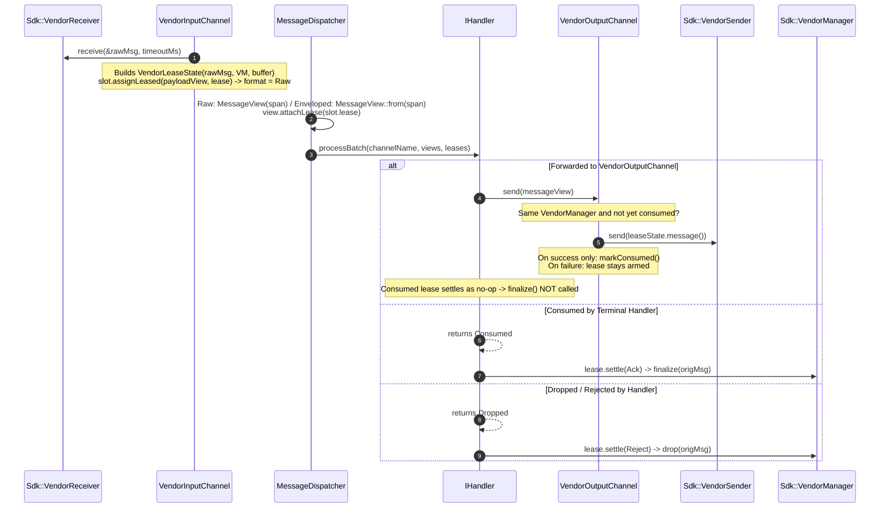

# 007: 3rd-Party Vendor SDK Transport & Consuming Lifecycle (`backend/vendor`)

## 1. Overview & Problem Statement

### Why It's Needed
In `fcfe1d9` – `303528b`, the Proxy pipeline was extended to integrate a proprietary 3rd-party transport SDK (`backend/vendor`). Unlike OS buffer-owning transports (`file`, `socket`, `uds`, `shm`, `inproc`), the vendor SDK imposes strict object-ownership and lifecycle rules:
1. **Opaque SDK Types**: The SDK exposes `VendorManager`, `VendorReceiver`, `VendorSender`, and `VendorMessage` types whose internal state and header maps (`std::map<std::string, std::string>`) must be preserved.
2. **Dual Payload Delivery Modes**: `VendorMessage` delivers its payload via two mutually exclusive methods:
   - **Mode A (`VendorBytePayload { data, length }`)**: An in-memory byte pointer and length owned directly by `VendorMessage`.
   - **Mode B (`payloadFilePath`)**: A filesystem path on disk from which the message payload must be read into memory.
3. **Mandatory Settlement**: Every received `VendorMessage` must be settled via `VendorManager::finalize(msg)` (when consumed) or `VendorManager::drop(msg)` (when rejected).
4. **Consuming Forward Semantics**: When a handler forwards a received message to a `VendorOutputChannel`, the channel must pass the **exact received `VendorMessage` instance** into `VendorSender::send(origMsg)` without calling `finalize(origMsg)`. In 1-to-N fan-out (`SplitHandler`), the first output channel consumes the original `VendorMessage` and subsequent output channels construct a new `VendorMessage` from the payload bytes.

### Evolution Across Four Iterations
1. **Iteration 1 — In-Band Registry PoC (`fcfe1d9`)**: Wrapped `VendorMessage` in `ScopedVendorMessage` stored in a mutex-guarded `VendorBackend::m_inFlightMessages` map keyed by `VendorMetadata { uint64_t messageId }` in the wire envelope, settling via `VendorBackend::onMessageResult()`.
2. **Iteration 2 — Out-of-Band `Backend::Lease` (`168ad1d`)**: Eliminated `VendorMetadata`, `ScopedVendorMessage`, and the backend hash map/mutex. `VendorInputChannel::receiveSlot()` attaches a move-only `Backend::Lease` owning `VendorLeaseState(std::move(rawMsg), m_manager)` directly onto `BufferSlot::lease`.
3. **Iteration 3 — Consuming Forward via `MessageView` (`3442deb`)**: Encapsulated an `ObserverPtr<Lease>` inside `Backend::MessageView`. When a handler calls `m_outputChannel->send(messageView)`, `VendorOutputChannel::send(const MessageView&)` consumes the `VendorLeaseState` from `messageView`, extracts the original `Sdk::VendorMessage` via `takeMessage()`, and sends it directly through `VendorSender::send(origMsg)`, disarming the `Lease` so `finalize()` is not called.
4. **Iteration 4 — Dual-Mode Payload Ingestion & Zero-Copy Leased Views**: `BufferSlot::assignLeased(view, lease)` and `MessageTask::assignLeased(name, view, lease)` bind a read-only payload view to the `Lease` that owns it, so `VendorInputChannel` never copies payloads into strategy scratch buffers (`batchBuffers` or `MessageTask::m_inlineBuffer`). Mode A (`{ data, length }`) exposes a zero-copy span directly over `VendorMessage` memory; Mode B (`payloadFilePath`) reads the file into a `BufferSlice` from `VendorBackend`'s `Common::Memory::BufferPool`, or memory-maps it (`Common::Io::MappedFile`) when it exceeds the block size or the pool is exhausted. The buffer is held in a `Common::Memory::DynamicBuffer` owned by `VendorLeaseState`.
5. **Iteration 5 — Hardening & Unified Memory Consolidation**:
   - Leased slots/tasks are explicitly tagged `Backend::PayloadFormat::Raw`; the dispatcher never guesses from envelope-parse failures.
   - `VendorOutputChannel` marks a message consumed only **after** `VendorSender::send()` succeeds, and only forwards leases from the **same** `VendorManager`.
   - Strategies call `BufferSlot::reset()` before each receive instead of poking individual fields.
   - **Lock-Free `BufferPool` Shared via `IBackend`**: `Common::Memory::BufferPool` uses a lock-free 64-bit tagged Treiber free-list (eliminating spinlock contention) and is owned directly by `Backend::IBackend` (`bufferPool()` / `setBufferPool()`), shared between `ThreadPoolStrategy` and `VendorBackend`.
   - **Channel Memory Capability (`IInputChannel::providesOwnMemory()`) & `IngressBatchScratch`**: `VendorInputChannel` overrides `providesOwnMemory()` to return `true`. `Core::Threading::Detail::IngressBatchScratch` skips allocating 64 KB / 1 MB scratch buffers and `prepareInline()` for memory-owning channels, and pre-attaches `BufferSlice`s directly to `BufferSlot::buffer` in `ThreadPoolStrategy` so normal backends receive straight into pool memory without an extra 64 KB `memcpy`.

---

## 2. Architecture & How It Works

### 2.1 End-to-End Vendor Transport Lifecycle



---

## 3. Design Decisions

### 3.1 Strictly Confined SDK Dependency (`backend/vendor`)
- **Decision**: All vendor SDK types (`VendorSdkStub.hpp` / proprietary SDK headers), `VendorLeaseState`, and `VendorLogSink` reside exclusively inside `backend/vendor`.
- **Rationale**: Zero vendor types or `#ifdef`s leak into `core`, `common`, `log`, or any handler implementation.

### 3.2 Out-of-Band `VendorLeaseState` Ownership
- **Decision**: `VendorLeaseState` implements `Backend::ILeaseState` and holds `Sdk::VendorMessage m_message` and `std::shared_ptr<Sdk::VendorManager> m_manager` by value/shared pointer.
- **Rationale**: Guarantees lock-free, single-owner RAII settlement across `SimpleExecutionStrategy`, `SequentialStrategy`, `DedicatedThreadStrategy`, and `ThreadPoolStrategy`.

### 3.3 Explicit Payload Format Instead of Envelope Guessing
- **Decision**: `BufferSlot` and `MessageTask` expose `format()` (`Backend::PayloadFormat::{Enveloped, Raw}`); `Detail::dispatchReceivedBatch()` receives a parallel `formats` span and wraps `Raw` payloads directly in a `MessageView`.
- **Rationale**: Inferring "raw" from a failed `MessageView::from()` would misparse vendor payloads that happen to start with a valid envelope header and would silently accept corrupt frames from other leased transports.

### 3.4 Mode B Memory Bound: Pool + Private Mapping
- **Decision**: Payload files that fit a pool block are read into the `BufferPool`; anything else is `mmap`ed privately (`Common::Io::MappedFile`, a `DynamicBuffer` alternative).
- **Rationale**: The previous unbounded `std::vector` fallback defeated the fixed-size pool. Mapping is zero-copy, bounded by the page cache, and stays valid after the SDK unlinks the file on `finalize()`.

### 3.5 Unified Lock-Free Memory Pool, Direct-to-Slice Ingress & Channel Memory Capability
- **Decision**:
  1. `Common::Memory::BufferPool` is implemented as a lock-free 64-bit tagged Treiber stack (`(tag << 32) | index`) owned per `Backend::IBackend` instance (`bufferPool()` / `setBufferPool()`) and shared with `ThreadPoolStrategy`.
  2. `Backend::IInputChannel::providesOwnMemory()` declares whether an input channel supplies its own payload memory (`true` for `VendorInputChannel`, `false` by default).
  3. `Core::Threading::Detail::IngressBatchScratch` unifies slot preparation across all execution strategies: skipping scratch buffers completely when `providesOwnMemory()` is `true`, reusing L2/L3-hot scratch arrays in synchronous strategies, and pre-attaching `BufferSlice`s directly to `BufferSlot::buffer` in `ThreadPoolStrategy` so kernel reads land directly in pool memory without an intermediate `batchBuffers` `memcpy`.
- **Rationale**: Eliminates duplicate 16 MB `BufferPool` instances, removes global singleton state leakage across unit tests, eliminates spinlock contention between pollers and workers, and avoids both dead scratch allocations on vendor channels and 64 KB intermediate copies on normal channels.

### 3.6 Consuming Forward Preconditions
- `VendorSender::send()` must succeed before the lease is marked consumed; otherwise the handler's settlement finalizes/drops the original.
- The lease's `VendorManager` must match the output channel's manager.
- **Assumption**: `VendorSender::send(const VendorMessage&)` does not invalidate the message's in-memory payload, because later fan-out channels still read it through the zero-copy view. Re-verify against the real SDK.

---

## 4. Concrete Examples

### 4.1 Consuming Forward (`backend/vendor/src/VendorOutputChannel.cpp`)
```cpp
auto* vendorState = dynamic_cast<VendorLeaseState*>(message.leaseState().get());
if (vendorState && !vendorState->isConsumed() && m_manager && vendorState->belongsTo(*m_manager)) {
    if (!m_sender->send(vendorState->message())) {
        return false; // lease stays armed -> handler settlement finalizes/drops
    }
    vendorState->markConsumed();
    return true;
}
// otherwise: re-materialize a new VendorMessage from message.payload()
```

### 4.2 Leased Ingress (`backend/vendor/src/VendorInputChannel.cpp`)
```cpp
slot.reset();
// ... receive rawMsg, load Mode B file into pool slice or MappedFile ...
auto leaseState = std::make_unique<VendorLeaseState>(std::move(rawMsg), m_manager, std::move(fileBuffer));
const auto view = leaseState->payloadView();
slot.assignLeased(view, ::Backend::Lease(std::move(leaseState))); // slot.format() == PayloadFormat::Raw
```

### 4.3 Configuration
```toml
[config]
"vendor.pool_block_size" = 65536
"vendor.pool_block_count" = 256
```

---

## 5. Tasks / Checklist

- [x] Create `backend/vendor` package (`VendorBackend`, `VendorInputChannel`, `VendorOutputChannel`, `VendorLogSink`, `VendorSdkStub`) (`fcfe1d9`).
- [x] Replace in-band `VendorMetadata` registry with out-of-band `VendorLeaseState` and `IInputChannel::receiveSlot` (`168ad1d`).
- [x] Support consuming `VendorMessage` forwarding via `IOutputChannel::send(const MessageView&)` with 1-to-N fan-out fallback (`3442deb`).
- [x] Support dual-mode vendor payloads (Mode A zero-copy `{ data, length }` and Mode B `VendorBackend` `BufferPool` + oversized fallback) via `BufferSlot::externalView` and `MessageTask::assignExternalView()`.
- [x] Tag leased payloads with explicit `Backend::PayloadFormat::Raw` and remove dispatcher envelope-guessing fallback.
- [x] Mark consumed only after a successful `VendorSender::send()`; restrict consuming forward to the same `VendorManager`.
- [x] Replace `externalView` / `assignExternalView` with `BufferSlot::reset()` / `assignLeased()` and `MessageTask::assignLeased()`.
- [x] Replace unbounded Mode B heap fallback with `Common::Io::MappedFile`.
- [x] Allocate the vendor `BufferPool` lazily, once.
- [x] Move `BufferSlot` and `DynamicBuffer` implementations into source files.
- [x] Upgrade `Common::Memory::BufferPool` to a lock-free tagged Treiber stack, expose per-backend pool ownership on `Backend::IBackend`, add `IInputChannel::providesOwnMemory()`, and unify strategy slot preparation in `IngressBatchScratch`.
- [ ] Verify the `VendorSender::send()` non-invalidation assumption against the real SDK.
- [x] Verify all lifecycle invariants in `test/TestVendorBackend.cpp`.

