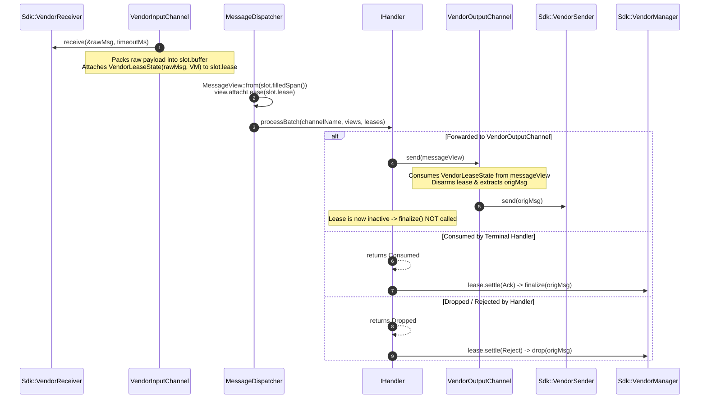

# 007: 3rd-Party Vendor SDK Transport & Consuming Lifecycle (`backend/vendor`)

## 1. Overview & Problem Statement

### Why It's Needed
In `fcfe1d9` – `303528b`, the Proxy pipeline was extended to integrate a proprietary 3rd-party transport SDK (`backend/vendor`). Unlike OS buffer-owning transports (`file`, `socket`, `uds`, `shm`, `inproc`), the vendor SDK imposes strict object-ownership and lifecycle rules:
1. **Opaque SDK Types**: The SDK exposes `VendorManager`, `VendorReceiver`, `VendorSender`, and `VendorMessage` types whose internal state and header maps (`std::map<std::string, std::string>`) must be preserved.
2. **Mandatory Settlement**: Every received `VendorMessage` must be settled via `VendorManager::finalize(msg)` (when consumed) or `VendorManager::drop(msg)` (when rejected).
3. **Consuming Forward Semantics**: When a handler forwards a received message to a `VendorOutputChannel`, the channel must pass the **exact received `VendorMessage` instance** into `VendorSender::send(origMsg)` without calling `finalize(origMsg)`. In 1-to-N fan-out (`SplitHandler`), the first output channel consumes the original `VendorMessage` and subsequent output channels construct a new `VendorMessage` from the payload bytes.

### Evolution Across Three Iterations
1. **Iteration 1 — In-Band Registry PoC (`fcfe1d9`)**: Wrapped `VendorMessage` in `ScopedVendorMessage` stored in a mutex-guarded `VendorBackend::m_inFlightMessages` map keyed by `VendorMetadata { uint64_t messageId }` in the wire envelope, settling via `VendorBackend::onMessageResult()`.
2. **Iteration 2 — Out-of-Band `Backend::Lease` (`168ad1d`)**: Eliminated `VendorMetadata`, `ScopedVendorMessage`, and the backend hash map/mutex. `VendorInputChannel::receiveSlot()` attaches a move-only `Backend::Lease` owning `VendorLeaseState(std::move(rawMsg), m_manager)` directly onto `BufferSlot::lease`.
3. **Iteration 3 — Consuming Forward via `MessageView` (`3442deb`)**: Encapsulated an `ObserverPtr<Lease>` inside `Backend::MessageView`. When a handler calls `m_outputChannel->send(messageView)`, `VendorOutputChannel::send(const MessageView&)` consumes the `VendorLeaseState` from `messageView`, extracts the original `Sdk::VendorMessage` via `takeMessage()`, and sends it directly through `VendorSender::send(origMsg)`, disarming the `Lease` so `finalize()` is not called.

---

## 2. Architecture & How It Works

### 2.1 End-to-End Vendor Transport Lifecycle



---

## 3. Design Decisions

### 3.1 Strictly Confined SDK Dependency (`backend/vendor`)
- **Decision**: All vendor SDK types (`VendorSdkStub.hpp` / proprietary SDK headers), `VendorLeaseState`, and `VendorLogSink` reside exclusively inside `backend/vendor`.
- **Rationale**: Zero vendor types or `#ifdef`s leak into `core`, `common`, `log`, or any handler implementation.

### 3.2 Out-of-Band `VendorLeaseState` Ownership
- **Decision**: `VendorLeaseState` implements `Backend::ILeaseState` and holds `Sdk::VendorMessage m_message` and `std::shared_ptr<Sdk::VendorManager> m_manager` by value/shared pointer.
- **Rationale**: Guarantees lock-free, single-owner RAII settlement across `SimpleExecutionStrategy`, `SequentialStrategy`, `DedicatedThreadStrategy`, and `ThreadPoolStrategy`.

---

## 4. Concrete Examples

### 4.1 `VendorLeaseState` Settlement & Extraction (`backend/vendor/src/VendorLeaseState.cpp`)
```cpp
void VendorLeaseState::settle(::Backend::Settlement outcome) noexcept
{
    if (!m_manager) {
        return;
    }
    switch (outcome) {
    case ::Backend::Settlement::Ack:
        m_manager->finalize(m_message);
        break;
    case ::Backend::Settlement::Reject:
    case ::Backend::Settlement::Release:
        m_manager->drop(m_message);
        break;
    }
}

Sdk::VendorMessage VendorLeaseState::takeMessage() noexcept
{
    return std::move(m_message);
}
```

---

## 5. Tasks / Checklist

- [x] Create `backend/vendor` package (`VendorBackend`, `VendorInputChannel`, `VendorOutputChannel`, `VendorLogSink`, `VendorSdkStub`) (`fcfe1d9`).
- [x] Replace in-band `VendorMetadata` registry with out-of-band `VendorLeaseState` and `IInputChannel::receiveSlot` (`168ad1d`).
- [x] Support consuming `VendorMessage` forwarding via `IOutputChannel::send(const MessageView&)` with 1-to-N fan-out fallback (`3442deb`).
- [x] Verify all lifecycle invariants in `test/TestVendorBackend.cpp`.

