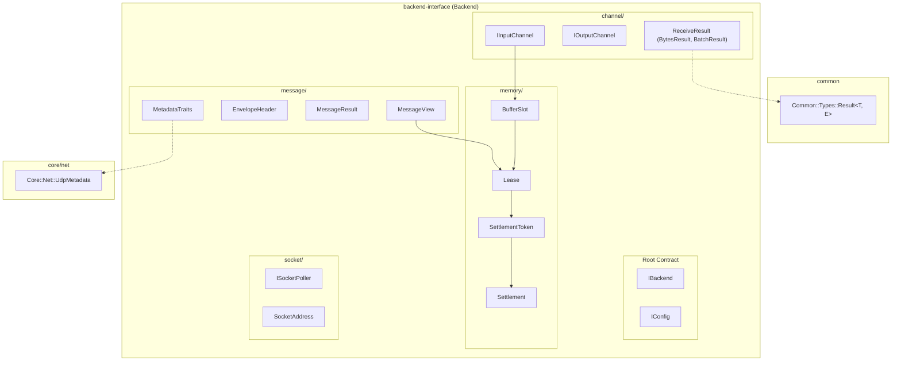

# 008: Backend Interface Domain Partitioning & Type Relocation

## 1. Overview & Problem Statement

### Why It Was Needed
Historically, `backend/interface` stored all interfaces, message types, poller primitives, and memory descriptors directly in the flat root directories `include/backend/` and `src/`. As the transport abstraction matured with additional capabilities (zero-allocation settlement tokens, vectorization buffer slots, OS socket pollers, protocol metadata), having all headers in a single flat folder caused several architectural issues:
1. **Domain Entanglement**: Channel contracts (`IInputChannel`, `IOutputChannel`), memory descriptors (`BufferSlot`, `Lease`, `Settlement`, `SettlementToken`), socket abstractions (`ISocketPoller`, `SocketAddress`), and message structures (`MessageView`, `EnvelopeHeader`, `PayloadFormat`) lacked physical boundary segregation.
2. **Namespace & Layer Clashes**: Placing `IBackend` and `IConfig` in an artificial `backend/core/` domain or nested namespace clashed directly with the top-level `core` library.
3. **Misplaced Utilities**: `Result.hpp` was defined under `Backend::Result`, even though value-or-error result types are foundational primitives belonging in `common` (`Common::Types::Result`).
4. **Concrete Protocol Coupling in Generic Interface**: `UdpMetadata` (a concrete 48-byte UDP network provenance layout) was located inside `backend/interface/include/backend/`, coupling abstract message framing to UDP networking.

---

## 2. Architecture & How It Works

### 2.1 Domain Layout in `backend-interface`
`backend/interface` is now organized strictly by cohesive functional domains:
- **Root (`backend/`)**:
  - `IBackend.hpp` / `IBackend.cpp`: Foundational transport interface for creating input/output channels and owning the shared buffer pool.
  - `IConfig.hpp` / `IConfig.cpp`: Abstract key-value configuration contract.
- **`backend/channel/`**:
  - `IInputChannel.hpp` / `IInputChannel.cpp`: Channel ingestion contract (`receiveSlot`, `receiveBatch`).
  - `IOutputChannel.hpp` / `IOutputChannel.cpp`: Channel transmission contract (`send`, `sendBatch`).
  - `ReceiveResult.hpp`: Typed outcome representations (`BytesResult`, `BatchResult`, `ReceiveError`).
- **`backend/memory/`**:
  - `BufferSlot.hpp` / `BufferSlot.cpp`: Target buffer span, byte count, and in-flight payload lease.
  - `Lease.hpp` / `Lease.cpp`: Move-only RAII payload lifetime ownership handle.
  - `Settlement.hpp`: Terminal message disposition (`Ack`, `Reject`, `Release`).
  - `SettlementToken.hpp` / `SettlementToken.cpp`: Zero-allocation completion token.
- **`backend/message/`**:
  - `EnvelopeHeader.hpp` / `EnvelopeHeader.cpp`: Packed binary framing preamble.
  - `MessageResult.hpp`: Handler message routing outcomes (`Forwarded`, `Consumed`, `Dropped`).
  - `MessageView.hpp` / `MessageView.cpp`: Read-only message envelope projection.
  - `MetadataTraits.hpp`: Trait registry mapping metadata structs to wire `ProtocolId`.
  - `PayloadFormat.hpp`: Wire format enum (`Enveloped` vs `Raw`).
  - `ProtocolId.hpp`: Extensible wire protocol identifiers.
- **`backend/socket/`**:
  - `ISocketPoller.hpp` / `ISocketPoller.cpp` / `SocketPollerFactory.cpp`: Cross-platform I/O polling abstraction.
  - `SocketAddress.hpp` / `SocketAddress.cpp`: IPv4, IPv6, and Unix domain address endpoint.
  - `PosixSocketPoller.*`, `KqueueSocketPoller.*`, `IoUringSocketPoller.*`: Platform polling engines.

### 2.2 Relocated Primitives
1. **`Result<T, E>` -> `Common::Types::Result<T, E>`**:
   Moved to `common/include/common/types/Result.hpp` under namespace `Common::Types`.
2. **`UdpMetadata` -> `Core::Net::UdpMetadata`**:
   Moved to `core/include/core/net/UdpMetadata.hpp` under namespace `Core::Net`. `Backend::MetadataTraits<Core::Net::UdpMetadata>` is specialized alongside the definition, keeping `backend-interface` 100% agnostic to concrete protocols.

---

## 3. Tasks / Checklist

- [x] Retain `IBackend` and `IConfig` in `backend/` root (`backend/IBackend.hpp`, `backend/IConfig.hpp`).
- [x] Partition channel interfaces into `backend/channel/` (`IInputChannel.hpp`, `IOutputChannel.hpp`, `ReceiveResult.hpp`).
- [x] Group buffer and lifetime abstractions under `backend/memory/` (`BufferSlot.hpp`, `Lease.hpp`, `Settlement.hpp`, `SettlementToken.hpp`).
- [x] Group message and framing types under `backend/message/` (`EnvelopeHeader.hpp`, `MessageResult.hpp`, `MessageView.hpp`, `MetadataTraits.hpp`, `PayloadFormat.hpp`, `ProtocolId.hpp`).
- [x] Group socket polling and endpoint abstractions under `backend/socket/` (`ISocketPoller.hpp`, `SocketAddress.hpp`).
- [x] Move `Result.hpp` to `common/include/common/types/Result.hpp` under `Common::Types`.
- [x] Move `UdpMetadata.hpp` to `core/include/core/net/UdpMetadata.hpp` under `Core::Net`.
- [x] Update all includes across `backend/*`, `core`, `handler/*`, `test/*`, `benchmark`, and documentation.
- [x] Update and verify Conan packaging export for `common`, `backend-interface`, and `core`.
- [x] Recompile with GCC 16 and verify all 95 unit test cases pass.

