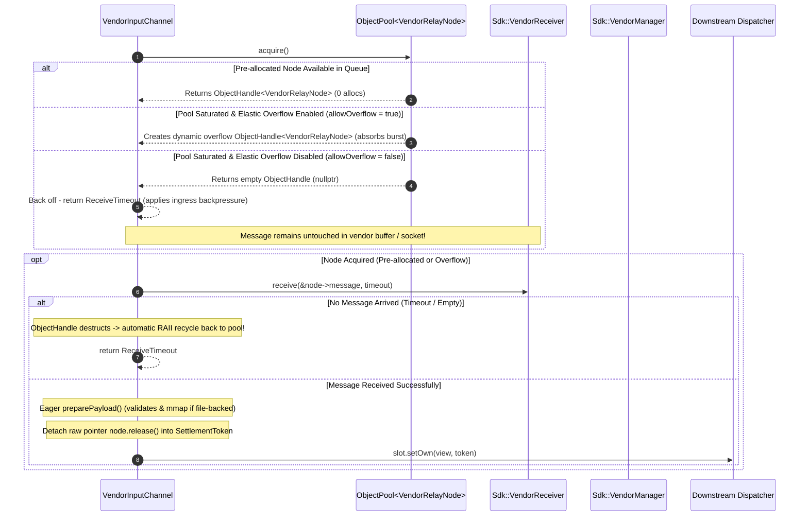

# 009: Vendor Relay Pool Hardening & Backpressure Invariant (`backend/vendor`)

## 1. Overview & Problem Statement

### Why It's Needed
In high-throughput benchmarks and sustained traffic bursts, the original `VendorRelayPool` introduced in `fcfe1d9` / `168ad1d` exhibited two critical reliability and performance bottlenecks:

1. **Premature Receive Drops (Absence of Ingress Backpressure)**:
   In `VendorInputChannel::receiveSlot()`, the channel unconditionally polled `m_receiver->receive(&rawMsg, timeout)` *before* checking whether the internal stationary pool had available slots. When all pool nodes were currently in flight across downstream handler threads, `m_relayPool->acquire()` returned `nullptr`. Because the message had already been pulled off the 3rd-party vendor receiver queue, `VendorInputChannel` had no choice but to call `m_manager->drop(rawMsg)` and report `ReceiveFailure`. Under heavy load, this caused dropped messages even though the vendor transport itself had buffering capacity.

2. **$\mathcal{O}(N)$ Linear Scan Contention**:
   `VendorRelayPool::acquire()` traversed an array of `VendorRelayNode`s using sequential atomic compare-and-exchange operations (`compare_exchange_strong`) across all slots from index `0` to `capacity - 1`. Under high occupancy, each acquire iterated across hundreds of cache lines, inducing cache-line bouncing and latency spikes on the ingress poller thread.

3. **Burst Capacity Constraint**:
   If downstream processing experienced transient lag (e.g. disk I/O or downstream socket stalls), a hard cap without overflow spilled messages to the drop floor.

---

## 2. Architecture & How It Works

### 2.1 Pre-Acquisition Backpressure Protocol
To guarantee zero message loss at the ingestion boundary, `VendorInputChannel::receiveSlot()` enforces an **acquire-before-receive** invariant:

By acquiring the relay slot *prior* to pulling from `m_receiver`:
- No message is ever popped from the vendor queue unless a container is ready to hold it.
- **Pre-allocated Steady State**: Nodes are popped from the pre-allocated pool with zero heap allocations on the hot path.
- **Elastic Burst Absorption (`allowOverflow = true`)**: If incoming traffic spikes beyond stationary capacity, the pool dynamically allocates an elastic node so that zero messages are dropped. When traffic subsides and the burst node is returned, `m_availableObjects.tryPush()` rejects it because the pre-allocated queue is already full, and `std::unique_ptr` automatically deallocates the burst memory back to the OS.
- **Strict Backpressure Mode (`allowOverflow = false`)**: If elastic overflow is disabled, `VendorInputChannel` leaves the incoming data in the vendor SDK/OS transport buffer, propagating natural backpressure up the stack.

### 2.2 Generalized `Common::Memory::ObjectPool<T>` and `ObjectHandle<T>` in `common`
The custom pool class has been completely eliminated from `backend/vendor`:
- **`Common::Memory::ObjectPool<T>`** (`common/include/common/memory/ObjectPool.hpp`):
  - Backed by `Common::Queue::BoundedMpmcQueue<std::unique_ptr<T>>`.
  - Sized at construction time with runtime capacity.
  - Returns lightweight RAII **`ObjectHandle<T>`** leases. Destroying an `ObjectHandle<T>` automatically recycles the underlying node back into its parent pool without manual intervention.
  - Zero heap allocations during steady-state `acquire()` and recycling.
  - Supports `handle.release()` for handoffs to foreign tokens (`SettlementToken`).
  - Supports elastic burst overflow fallback when capacity is saturated.
  - Auto-shrinking: when burst traffic subsides, excess burst objects returned to a full pool are rejected by `m_availableObjects.tryPush()` and automatically destroyed by `std::unique_ptr`.
- **`VendorRelayNode`**:
  - Moved to public header `backend/vendor/include/backend/vendor/VendorRelayNode.hpp`.
  - Performs eager mapping in `preparePayload()` upon arrival so disk-backed files are validated upfront at the channel boundary.
  - Preserves the `MappedFile` mapping directly as a member variable across the token lifetime until recycled.
- **`VendorInputChannel`**:
  - Directly embeds `Common::Memory::ObjectPool<VendorRelayNode> m_relayPool;` as a direct value member, eliminating heap indirection and wrapper types entirely.

---

## 3. Design Decisions & Trade-Offs

1. **Pre-Acquire vs. Post-Acquire Rollback**:
   - *Considered*: Receiving into a temporary stack `VendorMessage` and re-queuing it back if the pool is full.
   - *Rejected*: Vendor SDKs generally do not provide an `unreceive()` or push-back API. Once pulled, dropping is irreversible.
   - *Decision*: Pre-acquire the node. If `receive()` times out or fails, the RAII `ObjectHandle` automatically recycles the unused node back to the pool on scope exit.

2. **`ObjectPool<T>` & `ObjectHandle<T>` Generalization in `common`**:
   - *Decision*: Extracting `ObjectPool<T>` and RAII `ObjectHandle<T>` provides a reusable, typed object pool counterpart to `Common::Memory::BufferPool` (which pools raw byte blocks).

3. **Eager Ingress Mapping in `preparePayload()`**:
   - *Decision*: Memory mapping for file-backed messages is initiated eagerly inside `preparePayload()` during `receiveSlot()` rather than deferred to `payloadView()`. If the file is missing or corrupted, ingress drops the message immediately at the boundary and avoids passing invalid references downstream.

---

## 4. Verification & Testing

- Unit tests in `test/TestMpmcQueue.cpp` verifying `BoundedMpmcQueue` runtime sizing and move-only types.
- Unit tests in `test/TestObjectPool.cpp` verifying `ObjectPool<T>` basic acquire/release, burst overflow, auto-shrinking, and multi-threaded concurrent churn.
- Unit tests in `test/TestVendorBackend.cpp` validating backpressure retention, consuming forward, and settlement callbacks.

---

## 5. Tasks / Checklist

- [x] Branch creation: `feat/vendor-relay-pool-hardening`.
- [x] Implement `Common::Queue::BoundedMpmcQueue<T>` with runtime-configured capacity in `common/include/common/queue/BoundedMpmcQueue.hpp`.
- [x] Implement `Common::Memory::ObjectPool<T>` and `ObjectHandle<T>` in `common/include/common/memory/ObjectPool.hpp`.
- [x] Add unit tests for `BoundedMpmcQueue` in `test/TestMpmcQueue.cpp`.
- [x] Add unit tests for `ObjectPool` in `test/TestObjectPool.cpp`.
- [x] Move `VendorRelayNode.hpp` into public include `backend/vendor/include/backend/vendor/VendorRelayNode.hpp`.
- [x] Embed `ObjectPool<VendorRelayNode>` directly as value member in `VendorInputChannel`.
- [x] Enforce pre-acquire backpressure and eager `preparePayload()` in `VendorInputChannel::receiveSlot`.
- [x] Format all touched files with `clang-format`.
- [x] Verify build and run all test cases (`proxy_tests`).
- [x] Request explicit user approval prior to git commit.

