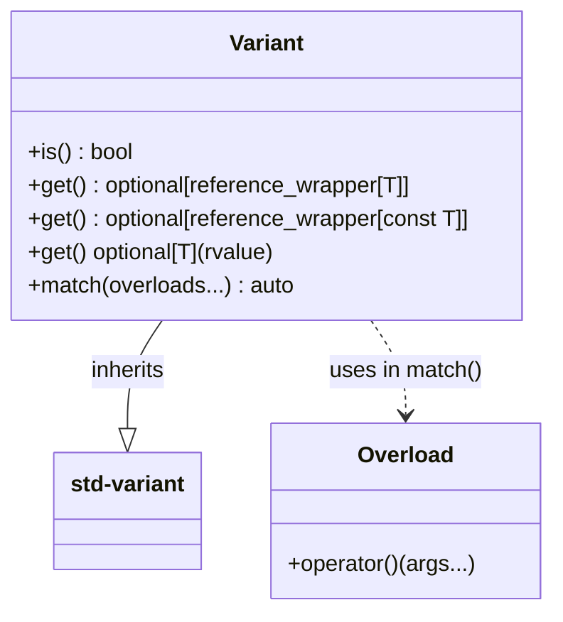

# Variant Wrapper (`Common::Types::Variant`)

## Overview & Problem Statement
`std::variant` in C++ provides type-safe unions, but standard access and inspection syntax is verbose and cumbersome:
- Checking whether an alternative is active requires free function calls: `std::holds_alternative<T>(v)`.
- Extracting values requires choosing between throwing exceptions (`std::get<T>(v)`) or pointer checking (`std::get_if<T>(&v)`).
- Pattern matching requires `std::visit` combined with boilerplate visitor structs or manually written `overload` helper structs at each call site.

`Common::Types::Variant<Ts...>` provides an ergonomic, zero-overhead wrapper extending `std::variant<Ts...>` that integrates seamlessly into standard variant usage while providing concise, intuitive member functions.

---

## Architecture & How It Works



### Key Components

1. **`Common::Types::Overload<Fs...>`**:
   Variadic template struct using the overload pattern:
   ```cpp
   template <typename... Fs>
   struct Overload : Fs... {
       using Fs::operator()...;
   };
   template <typename... Fs>
   Overload(Fs...) -> Overload<Fs...>;
   ```

2. **`Common::Types::Variant<Ts...>`**:
   Directly inherits `std::variant<Ts...>`, retaining all constructors, assignment operators, and compatibility with standard algorithms and traits.
   - **`is<T>()`**: Returns `bool` checking if the active alternative matches `T` (replaces `std::holds_alternative<T>`).
   - **`get<T>()`**: Returns `std::optional<std::reference_wrapper<T>>` for lvalues (or `std::optional<T>` by value when invoked on rvalues), replacing both `std::get` and `std::get_if`.
   - **`match(callables...)`**: Automatically constructs an `Overload` set and dispatches to `std::visit`, supporting lvalue, const lvalue, and rvalue moves.

---

## Concrete Examples

```cpp
#include "common/types/Variant.hpp"

using Value = Common::Types::Variant<int, std::string, double>;

Value v = std::string("hello");

// 1. is<T>()
if (v.is<std::string>()) {
    // alternative active
}

// 2. get<T>() -> optional
if (auto opt = v.get<std::string>()) {
    std::cout << opt->get() << "\n";
    opt->get() = "world"; // direct in-place mutation
}

// 3. match(callables...)
int len = v.match(
    [](int i) { return i; },
    [](const std::string& s) { return static_cast<int>(s.size()); },
    [](double d) { return static_cast<int>(d); }
);
```

---

## Tasks / Checklist

- [x] Create `common/include/common/types/Variant.hpp` with `Common::Types::Variant` and `Common::Types::Overload`.
- [x] Implement `is<T>()` member function.
- [x] Implement `get<T>()` member function returning `std::optional` (with lvalue reference wrapper and rvalue move support).
- [x] Implement `match()` member function using the overload pattern.
- [x] Export `common` conan recipe to cache.
- [x] Add comprehensive Catch2 unit tests in `test/TestVariant.cpp`.
- [x] Refactor all existing `std::variant` usages across `backend-interface`, `core`, and handlers to `Common::Types::Variant`.
- [x] Verify full build and test suite passes on both C++20 (`gcc16-debug`) and C++17 (`gcc16-debug-17`).

