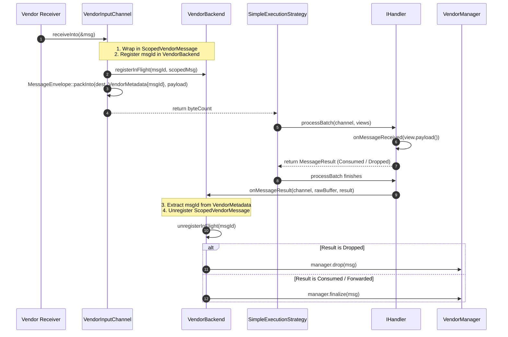

# 3rd-Party Vendor Backend Integration (PoC)

## 1. Overview & Problem Statement

### Why It's Needed
To integrate a proprietary 3rd-party transport SDK into the proxy pipeline for an upcoming Proof of Concept (PoC). The 3rd party SDK is delivered with private implementations and opaque types, imposing strict constraints:
- **Opaque SDK Types**: We only have access to opaque types and cannot modify their implementations.
- **Proprietary Transport Abstractions**: The vendor provides its own `Sender`, `Receiver`, and `Message` types.
- **Message Ownership & Lifecycle**: The vendor SDK requires messages to be explicitly finalized or dropped by a central `VendorManager` object. Messages must remain alive and owned during handler processing.
- **Unique Message ID**: Each vendor message has a unique identifier that can be used to correlate the message across its lifecycle.
- **PoC Goal**: Performance is of no concern; reducing architectural complexity, eliminating threading race conditions, and maximizing traceability and debuggability are paramount.
- **External Logging**: The vendor provides its own logging mechanism via a central management object that must be initialized once and unified under `Proxy::Log`.

### The Solution
1. **Standard Proxy Envelope Framing**: `VendorInputChannel` writes Proxy's standard binary wire format into `destination`. The vendor `messageId` is packed into the 8-byte `metadata` section, and the raw vendor payload is packed into the `payload` section. Handlers process standard `MessageView` without any special codecs or configuration.
2. **Backend-Driven Message Lifecycle (`ScopedVendorMessage`)**: `VendorBackend` owns an in-flight registry of move-only `ScopedVendorMessage` instances mapped by `messageId`. When the handler finishes, `IHandler::processBatch` automatically reports the decision to `VendorBackend::onMessageResult()`, where the backend extracts the `messageId` from the standard envelope header and calls `vendorManager.finalize()` (for `Consumed`/`Forwarded`) or `vendorManager.drop()` (for `Dropped`).
3. **Simplified Execution Strategy (`SimpleExecutionStrategy`)**: Provides a minimal, single-threaded, fully deterministic execution loop for transparent tracing and lldb/gdb debugging.
4. **Vendor Log Adapter**: `VendorLogSink` conforming to `Proxy::Log::ILogSink` wrapping the vendor's logger management object.

---

## 2. Architecture & Lifecycle Data Flow



---

## 3. Design Decisions & Trade-Offs

### 3.1 Proprietary SDK Isolation (`backend/vendor`)
- **Decision**: All 3rd-party headers, forward declarations of opaque types, and proprietary SDK linkages remain strictly confined to the backend target (`backend/vendor`).
- **Rationale**: Keeps `core`, `log`, and existing handlers completely independent of vendor headers, preserving modularity and compilation speed.

### 3.2 Metadata-Driven Correlation (Option 1)
- **Decision**: Embed `VendorMetadata { uint64_t messageId }` into the standard `MessageEnvelope` metadata section during ingestion.
- **Rationale**:
  - Handlers continue to consume standard `MessageView` without any modifications or vendor knowledge.
  - No synthetic handle generation is needed; the vendor's own message ID serves as the correlation key.
  - Works transparently with all execution strategies (`SimpleExecutionStrategy`, `SequentialStrategy`, `DedicatedThreadStrategy`, `ThreadPoolStrategy`).

### 3.3 Backend Ownership & RAII (`ScopedVendorMessage`)
- **Decision**: `VendorBackend` owns an in-flight map of `ScopedVendorMessage` instances, and `VendorBackend::onMessageResult()` drives `finalize()` vs `drop()`.
- **Rationale**:
  - Completely avoids single "active message" temporal coupling in channels.
  - If a message processing fails unexpectedly, `ScopedVendorMessage`'s destructor guarantees a safety `drop()` call without leaking SDK resources.

### 3.4 Minimalist "Simple" Execution Strategy
- **Decision**: Implement a synchronous, deterministic strategy (`SimpleExecutionStrategy`) executing round-robin channel polling and handler dispatching in a single straightforward loop.
- **Rationale**: Eliminates multi-threading concurrency issues, queues, and context switching. In `gdb`/`lldb`, the stack trace directly pinpoints the exact line of execution from ingress through handler logic to egress.

### 3.5 Message Framing & Envelope Unification (`backend-interface`)
- **Decision**: Unify `MessageEnvelope`, `MessageView` (with `from()`), `EnvelopeHeader`, `ProtocolId`, `UdpMetadata`, and `MessageResult` under the `Backend` namespace inside `backend/interface`.
- **Rationale**:
  - Ingress transport channels (`backend-socket`, `backend-file`, `backend-vendor`, etc.) are responsible for framing raw bytes into the proxy envelope. Moving `MessageEnvelope::packInto()` into `backend-interface` allows all backends to write valid wire formats natively without circular dependencies on `core`.
  - Completely eliminates pluggable codec abstractions (`IMessageEnvelope`), keeping the execution engine straightforward and zero-overhead.
  - Handlers and strategies across the entire project consume a single authoritative `Backend::MessageView`.
  - When processing completes, `VendorBackend::onMessageResult()` reads `messageId` directly from the metadata offset of the standard envelope and resolves `finalize()` vs `drop()`.

### 3.6 Header Metadata Handling (`std::map<std::string, std::string>`)
- **Decision**: Keep the intact `VendorMessage` in the backend's in-flight registry during message transit.
- **Rationale**:
  - The proprietary `VendorMessage` retains its internal header map (`std::map<std::string, std::string>`) inside `ScopedVendorMessage` throughout processing.
  - The envelope only needs to carry `VendorMetadata { uint64_t messageId }`. When the pipeline finishes, `VendorBackend::onMessageResult()` looks up the intact original message by ID, ensuring all vendor headers are retained for finalization or dropping without needing custom map wire serialization.

---

## 4. Concrete Examples

### 4.1 Ingress Channel (`VendorInputChannel`)

```cpp
Backend::BytesResult VendorInputChannel::receiveInto(
    Common::Compat::span<std::byte> destination,
    Timeout timeout)
{
    Sdk::VendorMessage rawMsg;
    if (!m_receiver->receive(&rawMsg, static_cast<int>(timeout.count()))) {
        return Backend::BytesResult::failure(Backend::ReceiveTimeout {});
    }

    const std::uint64_t msgId = rawMsg.getId();
    auto mgr = m_backend.vendorManager();

    // 1. Register with backend registry
    m_backend.registerInFlight(msgId, ScopedVendorMessage(std::move(rawMsg), *mgr));

    // 2. Pack VendorMetadata(msgId) + Payload into destination buffer
    VendorMetadata meta { msgId };
    std::string payload = m_backend.getInFlightPayload(msgId);

    auto metaSpan = Common::Compat::as_bytes(Common::Compat::span(&meta, 1));
    auto payloadSpan = Common::Compat::as_bytes(Common::Compat::span(payload.data(), payload.size()));

    std::size_t written = Backend::MessageEnvelope::packInto(
        destination,
        Backend::ProtocolId::Raw,
        metaSpan,
        payloadSpan);

    return Backend::BytesResult::success(written);
}
```

### 4.2 Backend Lifecycle Resolution (`VendorBackend::onMessageResult`)

```cpp
void VendorBackend::onMessageResult(
    std::string_view /*channelName*/,
    Common::Compat::span<const std::byte> rawMessage,
    const Backend::MessageResult& result)
{
    auto optView = Backend::MessageView::from(rawMessage);
    if (!optView) {
        return;
    }

    const auto* meta = optView->getMetadata<VendorMetadata>();
    if (!meta) {
        return;
    }

    auto scopedMsg = unregisterInFlight(meta->messageId);
    if (!scopedMsg) {
        return;
    }

    if (std::holds_alternative<Backend::Dropped>(result)) {
        scopedMsg->drop();
    } else {
        scopedMsg->finalize();
    }
}
```

### 4.3 Configuration Example (`config.toml`)

```toml
[backend]
type = "vendor"

[execution]
model = "simple"

[channel.ingress]
name = "vendor_in"
```

---

## 5. Tasks / Implementation Checklist

- [x] **Phase 1: Feature Branch & Test Scaffolding**
  - [x] Create feature branch `feat/vendor-poc-prep`.
  - [x] Create vendor SDK stubs (`backend/vendor/include/backend/vendor/VendorSdkStub.hpp`).
- [x] **Phase 2: Simple Execution Strategy**
  - [x] Declare `SimpleExecutionStrategy` in `core/include/core/threading/SimpleExecutionStrategy.hpp`.
  - [x] Implement `SimpleExecutionStrategy` in `core/src/threading/SimpleExecutionStrategy.cpp`.
  - [x] Integrate `SimpleModel` into `ExecutionModel` and `HandlerRunner`.
  - [x] Add unit tests in `test/TestSimpleExecutionStrategy.cpp`.
- [x] **Phase 3: Standard Envelope Framing in Vendor Ingress**
  - [x] Adopt standard Proxy binary envelope framing (`EnvelopeHeader` 18 B + `VendorMetadata` 8 B + payload).
  - [x] Move portable wire serialization helpers into `common/include/common/io/WireFormat.hpp`.
  - [x] Ensure `VendorBackend::onMessageResult()` reads `messageId` directly from the standard envelope header metadata.
- [x] **Phase 4: Vendor Backend & Channels**
  - [x] Define `VendorMetadata` (8-byte aligned `messageId`).
  - [x] Implement `ScopedVendorMessage` RAII guard.
  - [x] Implement `VendorBackend` with in-flight registry and `onMessageResult()` resolution.
  - [x] Implement `VendorInputChannel` packing `VendorMetadata` via `MessageEnvelope`.
  - [x] Implement `VendorOutputChannel` forwarding payloads to vendor sender.
  - [x] Add end-to-end integration test in `test/TestVendorBackend.cpp`.
- [ ] **Phase 5: Manual Integration (User Work)**
  - [ ] Replace `VendorSdkStub.hpp` with proprietary vendor SDK headers.
  - [ ] Link vendor library in `backend/vendor/CMakeLists.txt`.
  - [ ] Implement `VendorLogSink : public Proxy::Log::ILogSink` wrapping the vendor logger manager.
