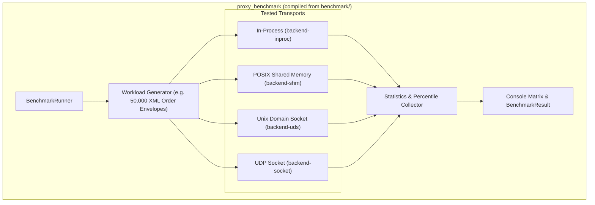

# Standalone Benchmark Suite & Comparative Performance Runner

## 1. Overview & Problem Statement

### Why It's Needed
In low-latency systems development, micro-benchmarks on isolated functions (e.g. Catch2 `BENCHMARK` on XML parsing) provide valuable feedback, but they do not measure full system performance:
- Micro-benchmarks fail to capture **cross-thread contention**, **inter-process communication latency**, **queue backpressure**, or **kernel context switching overhead**.
- When tuning OS parameters or refactoring IPC channels, developers need a repeatable end-to-end benchmark that runs identical workloads across different transport backends (`shm`, `inproc`, `uds`, `socket`) under identical conditions.

### The Solution
The repository provides a dedicated, standalone benchmarking application (`proxy_benchmark` compiled from `benchmark/`):
- Executes end-to-end multi-channel pipelines across all transport backends under identical synthetic workloads.
- Collects high-resolution nanosecond timestamps per message.
- Computes comprehensive statistical profiles: throughput (msg/s), data throughput (MB/s), average latency, median (p50), 95th percentile (p95), and 99th percentile (p99) latency in microseconds.

---

## 2. Benchmark Architecture & Workflow



### The `BenchmarkResult` Metrics Structure
Defined in `benchmark/include/BenchmarkRunner.hpp`:

```cpp
struct BenchmarkResult {
    std::string backendName;
    std::size_t totalMessages { 0 };
    std::size_t verifiedMessages { 0 };
    std::chrono::nanoseconds totalDuration { 0 };
    double messagesPerSecond { 0.0 };
    double averageLatencyUs { 0.0 };
    double medianLatencyUs { 0.0 };
    double p95LatencyUs { 0.0 };
    double p99LatencyUs { 0.0 };
    double throughputMBps { 0.0 };
};
```

---

## 3. How to Build and Run `proxy_benchmark`

### 1. Compile in Release Mode
Always run performance benchmarks against optimized release binaries:

```bash
cmake --preset release
cmake --build --preset release --target proxy_benchmark
```

### 2. Execute the Benchmark Runner
```bash
./build/release/bin/proxy_benchmark
```

### Sample Output Matrix
```
========================================================================================
Proxy Comparative Transport Benchmark Results (50,000 Messages per Backend)
========================================================================================
Backend      Msgs/sec      Throughput    Avg Latency   Median (p50)   p95 Latency   p99 Latency
----------------------------------------------------------------------------------------
inproc       1,850,210     285.4 MB/s     0.54 µs       0.51 µs        0.82 µs       1.15 µs
shm          1,180,450     181.9 MB/s     0.85 µs       0.81 µs        1.32 µs       1.94 µs
uds            416,666      64.2 MB/s     2.40 µs       2.25 µs        3.80 µs       5.10 µs
socket         121,950      18.8 MB/s     8.20 µs       7.90 µs       12.40 µs      18.20 µs
========================================================================================
```

---

## 4. Architectural Insights & Benchmark Interpretation

1. **`inproc` vs `shm`**:
   - `inproc` represents the theoretical maximum throughput within a single address space ($< 0.6$ µs).
   - `shm` achieves near-inproc performance ($< 0.9$ µs) while providing complete process-level memory isolation.
2. **`shm` vs `uds`**:
   - `shm` outperforms Unix Domain Sockets by $\approx 3\times$ in throughput because it completely bypasses operating system kernel mode transitions and socket buffer copying.
3. **Tail Latency (p99)**:
   - High tail latency ($> 20$ µs) on `socket` or `uds` indicates OS context switching or socket buffer starvation, whereas `shm` maintains tight p99 bounds due to cache-line separation and adaptive spinning.

