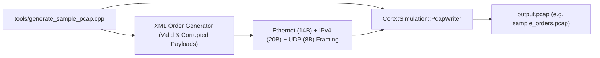

# Tools & Synthetic Traffic Generation (`tools/`)

## 1. Overview & Problem Statement

### Why It's Needed
During pipeline development, performance benchmarking, and simulation debugging:
- **Live Network Dependency**: Sending real UDP traffic from external test scripts requires bound network ports, root permissions on some interfaces, and may interfere with local network services.
- **Reproducible Test Data**: Developers testing validators and error counters need consistent test data containing known mixtures of valid payloads and intentionally corrupted messages (e.g. invalid XML syntax, missing required fields, or illegal price values).
- **Offline Packet Feeds**: Tools like `send_ingress.py`, the interactive simulation coordinator (`proxy_runner`), and native unit tests (`PcapReader`) require pre-recorded, nanosecond-stamped `.pcap` files.

### The Solution
The `tools/` subproject contains dedicated utility binaries for generating realistic synthetic network captures:
- **`generate_sample_pcap`**: Built with `Core::Simulation::PcapWriter`, it generates binary-compliant PCAP files containing structured Ethernet, IPv4, and UDP frames carrying mixed XML order payloads.

---

## 2. Binary Architecture & Layout



### Packet Composition Rules:
1. **Network Header Simulation**:
   - Source IP: `192.168.1.100` (Simulated client workstation)
   - Source Port: `54321`
   - Destination IP: `127.0.0.1` (Proxy ingress bind address)
   - Destination Port: `9123` (Configured ingress UDP port)
2. **Deterministic Payload Mixture**:
   - **Valid Orders**: Well-formed XML orders matching `chains/order.xsd` (with valid `orderId`, positive `price`, `quantity`, and recognized `symbol`).
   - **Corrupted Orders**: Every 5th packet intentionally omits required fields or injects invalid syntax, allowing developers to test drop accounting (`MessageResult::Dropped`) and validation error codes.

---

## 3. How to Build and Run `generate_sample_pcap`

### 1. Compile the Tool
```bash
cmake --preset debug --target generate_sample_pcap
```

### 2. Generate a Capture File
```bash
# Usage: ./bin/generate_sample_pcap [output_filename] [packet_count]

# Example: Generate 500 packets into test_traffic.pcap
./build/debug/bin/generate_sample_pcap test_traffic.pcap 500
```

### Sample Output:
```
Generating 500 simulated UDP packets into 'test_traffic.pcap'...
Successfully wrote 500 packets to test_traffic.pcap (Capture ready for replay).
```

---

## 4. Workflows & Integration

### Workflow 1: Feeding the Interactive Simulation Web UI
```bash
# Launch interactive step-wise simulation using the generated PCAP
./scripts/chain_runner.py chains/example_socket_chain.toml \
  --pcap test_traffic.pcap
```
Navigate to `http://localhost:8090` to inspect the generated packets, step through C++ handler decisions, and verify that the corrupted 5th packets are dropped with the expected validation error reasons.

### Workflow 2: Replaying Traffic over Live UDP (`send_ingress.py`)
```bash
# Replay the generated PCAP over real UDP sockets at 1,000 packets/sec
./scripts/send_ingress.py \
  --pcap test_traffic.pcap \
  --host 127.0.0.1 \
  --port 9123 \
  --rate 1000
```
